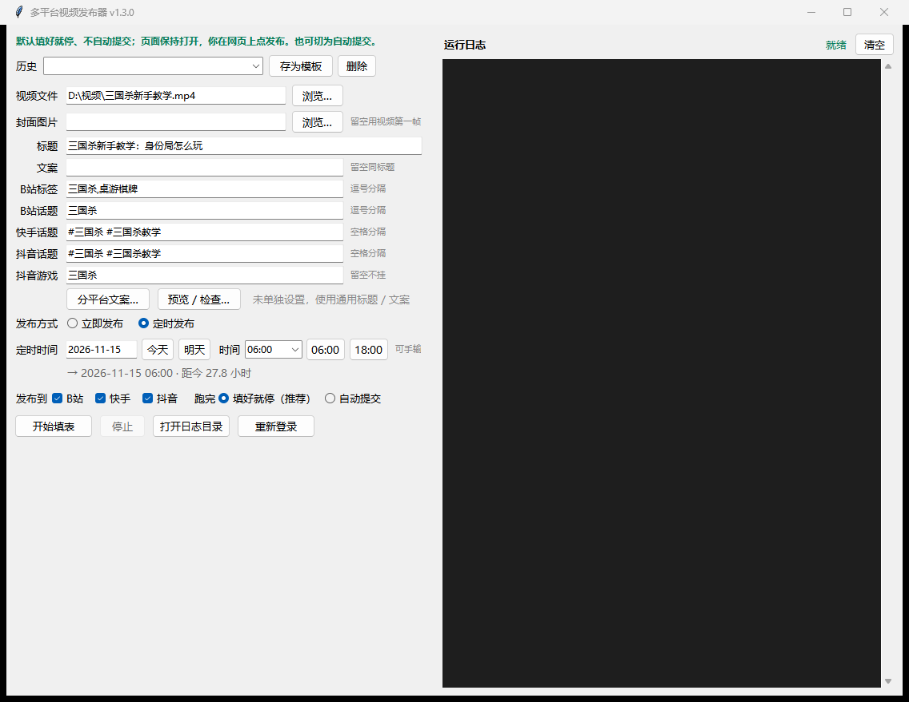
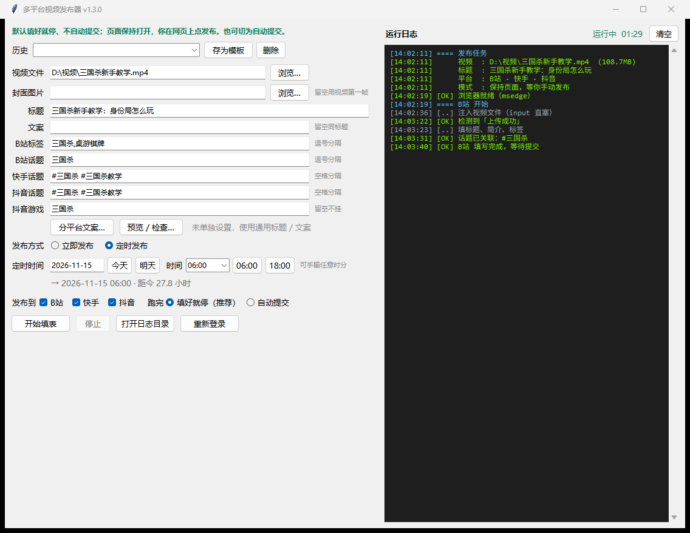
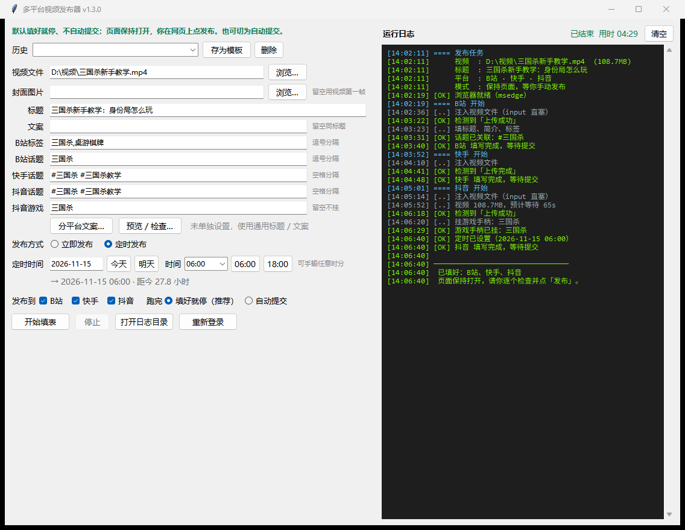

<div align="center">

# Multi-Platform Video Publisher (Publicador multiplataforma de vídeos)

[简体中文](README.md) · [English](README.en.md) · [日本語](README.ja.md) · [한국어](README.ko.md) · [Español](README.es.md) · [Français](README.fr.md) · [Deutsch](README.de.md) · [Русский](README.ru.md) · **Português (BR)** · [Italiano](README.it.md) · [Türkçe](README.tr.md) · [Tiếng Việt](README.vi.md) · [Bahasa Indonesia](README.id.md) · [ไทย](README.th.md) · [Polski](README.pl.md) · [Nederlands](README.nl.md) · [العربية](README.ar.md) · [हिन्दी](README.hi.md)

Um vídeo → **Bilibili · Kuaishou · Douyin** — as três páginas de publicação, preenchidas para você.

Grátis e de código aberto (MIT) · Exe portátil, sem instalação · Preenche e para: o botão “Publicar” é você quem aperta

[⬇️ Baixar (exe portátil)](https://github.com/moranzj/multi-platform-publisher/releases/latest) · [📖 Tutorial passo a passo (inglês)](docs/tutorial-en.md)

</div>

<p align="center">
  
  
  
</p>

## O que ele faz

Preencha o formulário **uma única vez** — a ferramenta abre as páginas de publicação das três plataformas no seu Chrome/Edge e completa tudo: upload do vídeo, título, descrição, hashtags, capa e agendamento. Ao terminar, as páginas ficam abertas — você confere e aperta “Publicar” você mesmo. A ferramenta nunca envia sem o seu comando.

- **Bilibili / Kuaishou / Douyin** — um vídeo, publicação em lote
- Títulos e descrições por plataforma, hashtags, capa (envie uma imagem ou use automaticamente o primeiro quadro do vídeo)
- **Publicação imediata ou agendada** (janelas validadas por plataforma: Bilibili +5 min–15 dias, Kuaishou +1 h–14 dias, Douyin +2 h–14 dias)
- Etiqueta “varinha de jogo” no Douyin (a versão web do Kuaishou não tem essa opção)
- Prévia e verificações antes de abrir qualquer coisa: tamanho de título/descrição, contagem de tags, proporção da capa, tamanho do arquivo
- Registro ao vivo, capturas de tela por etapa, modelos de histórico (até 50)
- Sem extensão de navegador — faça login uma vez por plataforma via QR code e a sessão fica salva

> A interface está em chinês; o [tutorial](docs/tutorial-en.md) explica cada campo com capturas de tela.

## Baixar e executar (Windows 10/11)

1. Baixe `multi-platform-publisher-<version>-exe.zip` em [Releases](https://github.com/moranzj/multi-platform-publisher/releases/latest).
2. Extraia em qualquer pasta **gravável** (não em Program Files).
3. Clique duas vezes em **`多平台发布器.exe`** — precisa apenas de Chrome ou Edge. Primeiro uso: clique em “重新登录” (Entrar novamente) e escaneie o QR code uma vez por plataforma.

> O exe não é assinado, então alguns antivírus podem sinalizá-lo — falso positivo comum de PyInstaller; adicione à lista de exceções. Prefere o código-fonte? `git clone` + `setup.bat` (Python 3.9+).

```powershell
python cli.py doctor    # autoteste do ambiente
python cli.py login     # login por QR, três abas
python cli.py publish --video "D:\v\clip.mp4" --title "Título" --ks-topics "#tag1 #tag2" --date 2026-11-20 --time 06:00
```

Comportamento padrão: preencher tudo e **parar** — você confere as páginas e clica em Publicar você mesmo (`--auto` habilita envio automático; `--now` publica imediatamente).

## Perguntas frequentes

| Sintoma | Solução |
|---|---|
| Trava na página de login | Sessão expirada — “重新登录” e escaneie de novo |
| “profile is busy” | Feche a janela do navegador da execução anterior |
| Antivírus sinaliza o exe | Falso positivo do PyInstaller — adicione à lista de exceções |
| A hashtag não virou “pílula” | O tópico não existe na plataforma — reformule |
| CAPTCHA | Resolva uma vez manualmente; publicar com muita frequência pode acionar verificações |

## Observações e limites

- As plataformas rodam em sequência; ~3–8 min por vídeo (depende do tamanho do arquivo)
- A sessão fica em `profile/` — **nunca compartilhe** (são as suas contas)
- Mudanças de layout das plataformas podem quebrar seletores; correções em `platforms/<plataforma>.py`
- Não é uma API oficial e não tem vínculo com Bilibili, Kuaishou ou Douyin. Automação de navegador pode violar os termos das plataformas — teste com uma conta secundária e publique com responsabilidade, por sua conta e risco.

## Licença

[MIT](LICENSE)
